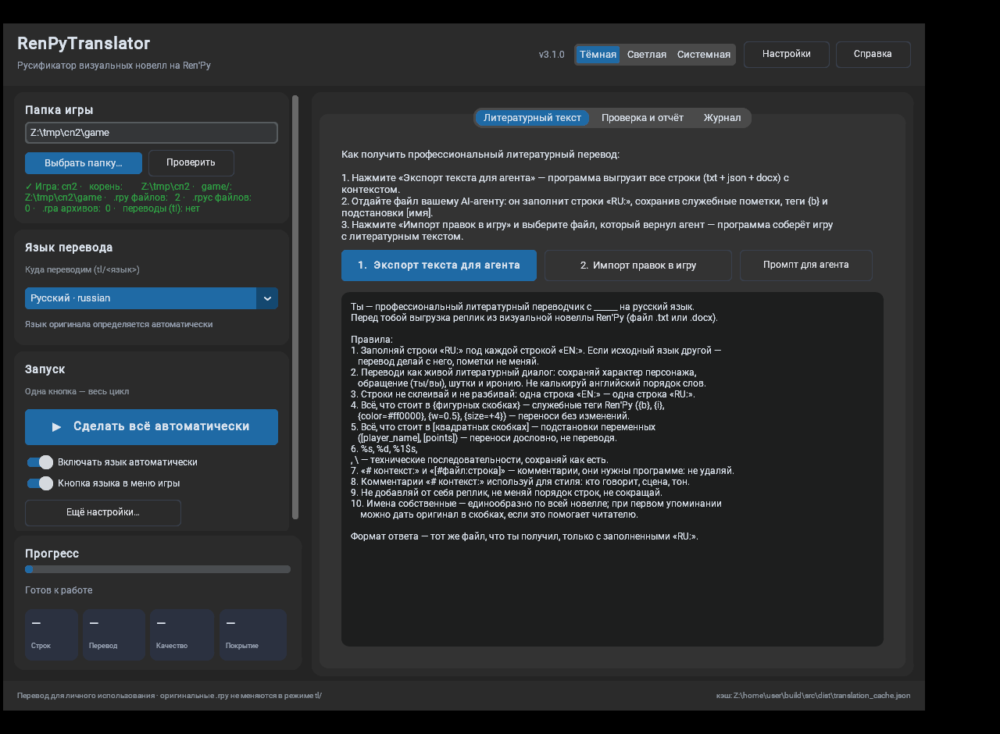
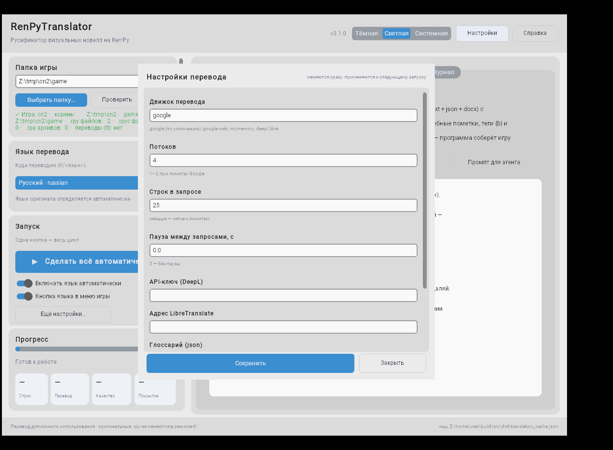
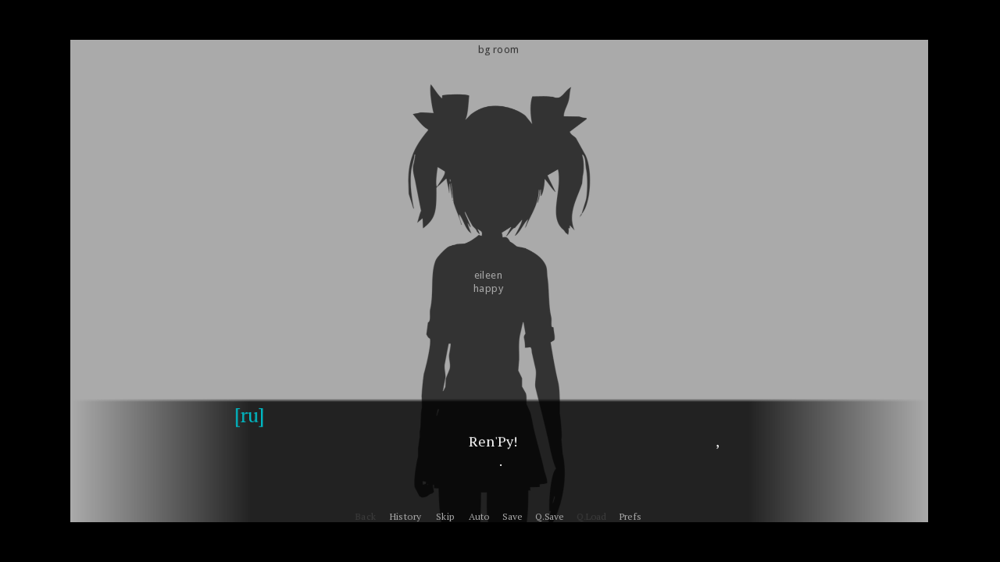
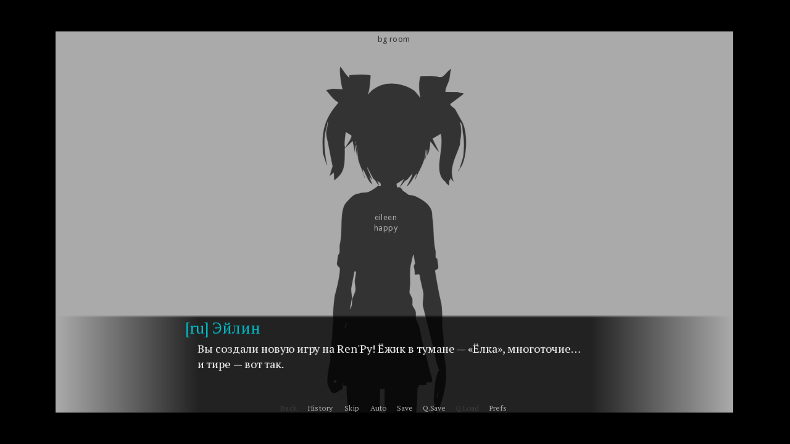

# RenPyTranslator 3.7.6

Полная автоматизация русификации визуальных новелл на движке **Ren'Py**:
находит текст в скриптах → переводит → собирает готовые файлы перевода
`game/tl/russian/`, либо подставляет перевод прямо в `.rpy`.

Есть **готовое окно** (двойной клик по `RenPyTranslator.exe`, ничего
устанавливать не нужно) и полноценная командная строка. В комплект входит
шрифт **PT Serif** с полной кириллицей — он ставится в игру автоматически,
поэтому русские буквы не превращаются в пустые квадратики. Программа не трогает
исполняемые файлы игры — только текстовые скрипты и каталог переводов.

---

## 1. Что программа умеет

| Шаг | Что делает |
|---|---|
| **Подготовка** | Распаковывает `*.rpa` (свой читатель RPA‑2.0/3.0/3.2 + `rpycdec`/`unrpa`), декомпилирует `*.rpyc` → `*.rpy` (`rpycdec` или `unrpyc.py`), предлагает «хак с `un.rpyc`» |
| **Разбор** | Находит реплики, нарратив, `extend`, варианты меню, UI‑строки экранов, `_("...")`‑строки, отображаемые имена персонажей |
| **Перевод** | Google (`deep-translator`), Google напрямую по HTTP, DeepL, LibreTranslate, оффлайн‑заглушка; батчи, потоки, ретраи, ограничение частоты |
| **Защита** | `[переменные]`, `{теги}`, `{color=#f00}`, `{w}`, `%s`, `%%`, `\n`, `\"`, `{{ }}`, `[[ ]]` — не переводятся, восстанавливаются после перевода |
| **Кэш** | `translation_cache.json` — повторный запуск не тратит лимиты API |
| **Не выглядит зависшим** | секундный таймер «прошло MM:SS», строка `… Перевод: X из Y` в журнале каждые 4 с, кнопка «Отмена» на каждом этапе |
| **Сборка** | Режим `tl` (штатные `translate`‑блоки + `strings`) или `replace` (правка `.rpy` на месте) |
| **Окно (GUI)** | Выбор папки, «Сделать всё автоматически», прогресс с ETA, живой журнал, настройки в `settings.json` |
| **Экспорт/импорт** | JSON / TXT / DOCX → правки вручную или через AI‑агента → импорт обратно (включая правленый `.docx`) |
| **Шрифты** | PT Serif (OFL) с полной кириллицей: чинит шрифты игры без русских букв или ставит красивый литературный шрифт для всего текста |
| **Безопасность** | Автоматический zip‑бэкап всех скриптов игры, удаление устаревших `.rpyc`, экранирование «чужих» `[скобок]` и `{тегов}` из перевода |
| **Логи** | `translator.log`, отчёт о непереведённых строках |

---

## 2. Установка

Нужен **Python 3.10+** (для `.exe` — не нужен, см. раздел 11).

```bash
pip install -r requirements.txt
```

Минимум для работы — вообще без зависимостей:
`pip install tqdm` (необязательно) и всё; перевод пойдёт через встроенный
HTTP‑движок `google-web`, декомпиляция не будет доступна, если `.rpy` уже есть.

Проверить окружение:

```bash
python main.py --doctor
```

---

## 3. Окно: двойной клик — и всё работает

Если у вас готовый `RenPyTranslator.exe`, никакой установки не нужно:
положите файл в любую папку (например, на рабочий стол) и запустите.



**Что происходит на экране**

1. **Папка игры** — нажмите «Выбрать папку…» и укажите папку `game`
   (внутри неё лежат `script.rpy`, `*.rpa`, `*.rpyc`). Можно указать и корень
   игры — программа сама найдёт `game/`. Справа появится зелёная строка:
   сколько найдено скриптов, архивов и какие уже есть переводы.
2. **«▶ Сделать всё автоматически»** — один щелчок. Программа сама:
   распакует `.rpa`, декомпилирует `.rpyc`, сделает zip‑бэкап, найдёт весь
   текст, переведёт его (с кэшем и защитой `[переменных]`/`{тегов}`),
   соберёт `game/tl/russian/`. Внизу бежит прогресс‑бар с ETA и журнал —
   всё видно, ничего не «висит молча».
3. **Запустите игру** → Настройки → Язык → **Русский**.
   Если такого пункта нет, поставьте галочку «Включать русский язык
   автоматически» и нажмите кнопку ещё раз.

**Литературный перевод (как у профессиональной локализации)**

1. «**1. Экспорт текста для агента**» → выберите папку. Появятся три файла:
   `.txt` (отправить AI‑агенту), `.json` (резервная копия), `.docx` (если
   удобнее править в Word).
2. Отдайте агенту `.txt` и попросите заполнить строки `RU:` литературным
   русским, не меняя `EN:`, номера `[#...]` и вставки `[переменная]`,
   `{тег}`, `%s`.
3. «**2. Импорт правок в игру**» → выберите возвращённый файл
   (`.txt`, `.json` или `.docx`) — программа подставит перевод и пересоберёт
   файлы игры. Если часть строк осталась пустой, она предложит дозаполнить
   их машинным переводом.



**Настройки** («⚙ Настройки») — движок перевода, ключ API, потоки, режим
сборки (`tl` или `replace`), глоссарий, бэкап. Всё сохраняется в
`settings.json` рядом с `.exe`; при следующем запуске папка игры и настройки
уже подставлены.

**Инструменты** — отдельные шаги (подготовка, перевод, сборка), открыть папку
игры, очистить кэш, открыть лог.

---

## 4. Быстрый старт из командной строки (3 команды)

```bash
# 1) ничего не меняя — посмотреть, что нашлось
python main.py --game "C:/Games/MyVN" --info

# 2) полная русификация в штатные файлы перевода
python main.py --game "C:/Games/MyVN/game" --mode tl --engine google

# 3) запустить игру → Настройки → Язык → Русский
```

Хотите, чтобы русский включался сам при первом запуске:

```bash
python main.py --game "C:/Games/MyVN/game" --mode tl --engine google --set-default-language
```

Полностью «навязчивый» вариант (язык включается при каждом запуске игры,
пока не удалите `game/tl/russian/zz_renpy_translator_language.rpy`):

```bash
... --set-default-language --force-language
```

Без аргументов (`python main.py` или двойной клик по `.exe`) открывается GUI.

---

## 5. Режимы работы

### `--mode tl` (рекомендуется)

Создаёт **штатную** структуру переводов Ren'Py:

```
game/tl/russian/script.rpy                       ← translate-блоки (реплики)
game/tl/russian/chapter_01.rpy
game/tl/russian/zz_renpy_translator_strings.rpy  ← UI-строки, варианты меню, имена
game/tl/russian/zz_renpy_translator_language.rpy ← (опционально) язык по умолчанию
game/tl/russian/zz_renpy_translator_hook.rpy     ← (опционально) runtime-хук
```

Формат — точно такой, какой генерирует сама команда Ren'Py `translate`:

```renpy
# script.rpy:42
translate russian start_1a2b3c4d:

    # e happy "I'm fine, [player_name]! {b}Really{/b}."

    e happy "У меня всё хорошо, [player_name]! {b}Честно{/b}."
```

* Оригинальные `.rpy` **не меняются**.
* Язык появляется в настройках игры (если в игре есть меню выбора языка),
  либо включается автоматически (`--set-default-language`).
* Идентификаторы блоков вычисляются по тому же алгоритму, что в движке
  (`<label>_<md5(code)[:8]>`), — проверено на реальной игре: **70/70 блоков
  совпали** с файлом, сгенерированным самим Ren'Py (см. раздел 11).

### `--mode replace`

Заменяет текст прямо в исходных `.rpy` (по точным смещениям символов,
отступы/комментарии/условия меню сохраняются), после чего удаляет рядом
лежащие `.rpyc`, чтобы движок перекомпилировал скрипт.

```bash
python main.py --game "C:/Games/MyVN/game" --mode replace --engine deepl --api-key XXX
```

Нужен для игр, где переключения языка нет вообще или где `tl` не подхватывается
(сильно переделанный движок). Всегда делайте бэкап — он создаётся
автоматически в `_renpy_translator_backup/`.

### 🔥 `--hook-fallback` — страховка

Добавляет в `tl/russian/` файл, который ставит `config.say_menu_text_filter`
и подменяет текст «на лету» по словарю. Работает даже если идентификаторы
блоков почему-то не совпали. Включайте, если после `--mode tl` в игре
остался английский текст:

```bash
python main.py --game "..." --mode tl --engine google --hook-fallback
```

---

## 6. Сценарий «экспорт → AI‑перевод → импорт» (лучшее качество)

Автоматический перевод хорош для понимания сюжета. Для литературного
качества используйте связку:

```bash
# (в окне это кнопки «1. Экспорт текста для агента» и «2. Импорт правок в игру»)

# 1) экспорт: JSON (с контекстом) + TXT (удобно для агента)
python main.py --game "C:/Games/MyVN/game" --export --format both \
               --output C:/work/myvn_text.json

# 2) отдайте myvn_text.txt AI-агенту со словами:
#    «Заполни все строки "RU:" литературным русским переводом.
#     Не меняй строки EN:, номера [#...], заголовки === и вставки
#     вида [переменная], {тег}, %s, \n.»

# 3) импорт готового файла + сборка tl/
python main.py --game "C:/Games/MyVN/game" --import C:/work/myvn_text.txt --mode tl
```

Импорт «аддитивный»: если в файле переведена только часть строк, остальные
добираются из кэша. Поддерживаются оба формата — JSON (поле `translation`)
и TXT (строки `RU:`, в том числе многострочные).

Формат JSON:

```json
{
  "meta": { "game_name": "...", "total_strings": 1234, "exported_at": "...",
            "source_files": ["script.rpy", "chapter_01.rpy"] },
  "strings": [
    { "id": "script.rpy:42", "file": "script.rpy", "line": 42, "kind": "dialogue",
      "label": "start", "character": "e", "original": "Hello, how are you?",
      "translation": "", "block_id": "start_1a2b3c4d",
      "context_before": "scene bg park with dissolve",
      "context_after": "show alex happy" }
  ]
}
```

Формат TXT:

```
=== script.rpy | label: start ===

[#script.rpy:42] (e)
EN: Hello, how are you?
RU: 

[#script.rpy:43] (Narrator)
EN: The sun was setting over the horizon.
RU: 
```

---

## 7. Шрифты: чтобы русские буквы не превращались в квадратики

Перевод — это текст, а текст рисуется шрифтом игры. Очень многие новеллы
используют собственный декоративный шрифт **без кириллицы** — и тогда вместо
русских букв игрок видит пустоту или квадраты. Это не ошибка перевода, но
выглядит как поломка.

Программа закрывает этот вопрос сама: в комплекте идёт **PT Serif**
(ParaType, лицензия SIL OFL 1.1 — свободно распространяется) в четырёх
начертаниях, с буквами `А–Я`, `Ё/ё`, знаками `«»`, `—`, `–`, `…`.

**Как это работает**

1. Программа читает скрипты игры и собирает все ссылки на шрифты
   (`gui.text_font = "..."`, `style say_dialogue: font "..."` и т.п.).
2. У каждого найденного файла проверяется таблица `cmap` — есть ли там
   кириллица (разбор TrueType напрямую, без внешних библиотек). Шрифты внутри
   `.rpa` тоже читаются.
3. В игру копируются файлы PT Serif, а в `game/tl/<язык>/` создаётся
   `zz_renpy_translator_fonts.rpy`, который:

   * подменяет через `config.font_replacement_map` именно те шрифты игры,
     где нет русских букв (с сохранением жирного и курсива);
   * в режиме «красиво» ставит PT Serif всем текстовым стилям.

**Три режима** (настройки → «Шрифт в игре», CLI `--font-mode`)

| Режим | Что делает |
|---|---|
| `pretty` (по умолчанию) | Весь текст игры — диалоги, имена, меню, интерфейс — набирается PT Serif. Аккуратно, единообразно, по-книжному. |
| `fix` | Трогает только шрифты без кириллицы; «родные» шрифты игры остаются. |
| `off` | Не трогать шрифты вообще. |

**Было / стало** (одна и та же новелла, шрифт игры без кириллицы):

| Без шрифтов | С PT Serif |
|---|---|
|  |  |

Слева от русского текста остались только латинские обрывки — букв просто нет
в шрифте. Справа — обычный читаемый текст, включая `Ё`, `ё`, `—`, `…`, `«»`.

**Лицензия.** PT Serif распространяется по SIL OFL 1.1; файл `OFL.txt`
копируется в игру вместе со шрифтами. Шрифт можно использовать и
распространять свободно, в том числе внутри собранной новеллы.

---

## 8. Полный справочник CLI

```
--game, -g ПУТЬ            папка game/ или корень игры
--mode, -m {tl,replace}    способ сборки (по умолчанию tl)
--engine, -e ДВИЖОК        google | google-web | deepl | libre | mock | none
--api-key КЛЮЧ             ключ DeepL / LibreTranslate
--libre-url URL            адрес LibreTranslate (например http://localhost:5000)
--lang ЯЗЫК                язык перевода (по умолчанию russian)
--source-lang ЯЗЫК         язык оригинала (по умолчанию auto)

--prepare                  только распаковать .rpa и декомпилировать .rpyc
--export                   экспорт текста (--format json|txt|docx|both)
--output, -o ФАЙЛ          куда сохранить экспорт
--import ФАЙЛ              импортировать перевод и собрать tl/replace
--set-default-language     включать русский язык в игре автоматически
--font-mode {pretty|fix|off}  шрифты с кириллицей (по умолчанию pretty)
--clear-cache              удалить translation_cache.json
--doctor                   состояние окружения
--info                     информация о найденной игре
--gui                      запустить окно

--cache ФАЙЛ               свой путь к кэшу
--log ФАЙЛ                 свой путь к логу
--glossary ФАЙЛ            JSON-словарь постоянных переводов (имена, термины)
--batch-size N             строк в одном пакете (25)
--workers, -j N            потоков перевода (4)
--delay СЕК                пауза между запросами (0)
--retries N                повторов при ошибках (4)
--timeout СЕК              таймаут запроса (30)
--no-cache                 не читать/не писать кэш
--no-backup                не создавать zip-бэкап
--no-names                 не переводить имена персонажей
--no-ui                    не переводить UI-строки
--set-default-language     config.default_language = "russian"
--force-language           включать русский при каждом запуске
--hook-fallback            добавить runtime-хук
--keep-orphan              не удалять прежние сгенерированные tl-файлы
--keep-rpyc                не удалять .rpyc рядом с изменёнными .rpy
--extract-all-rpa          извлекать из .rpa всё (по умолчанию только скрипты)
--dry-run                  ничего не писать на диск
-v / -q                    подробный / тихий режим
--version
```

Примеры:

```bash
# DeepL
python main.py -g "C:/Games/MyVN/game" -m tl -e deepl --api-key "xxxx:fx"

# свой LibreTranslate
python main.py -g "C:/Games/MyVN/game" -e libre --libre-url http://localhost:5000

# глоссарий (имена героев и термины всегда переводятся одинаково)
python main.py -g "C:/Games/MyVN/game" -e google --glossary glossary.json

# только подготовка архива/декомпиляция
python main.py -g "C:/Games/MyVN/game" --prepare

# проверить, что будет сделано, без записи на диск
python main.py -g "C:/Games/MyVN/game" -m replace --dry-run
```

### Глоссарий

```json
{
  "Eileen": "Эйлин",
  "Knights College": "Рыцарский колледж",
  "junior": "младшекурсник"
}
```

Записи из глоссария имеют приоритет над движком и попадают в кэш.

---

## 9. Кэш переводов

`translation_cache.json` рядом с программой (или `--cache ПУТЬ`):

```json
{
  "Hello, how are you?": "Привет, как дела?",
  "The sun was setting over the horizon.": "Солнце садилось за горизонтом."
}
```

* строка уже в кэше → не переводится повторно (в отчёте: «N из кэша»);
* кэш можно править руками, он же служит памятью между запусками;
* сброс: `python main.py --clear-cache` (или кнопка в GUI);
* непереведённые строки складываются в `translation_cache.json.failed.txt`.

---

## 10. Защита служебных конструкций

Перед отправкой в переводчик строка маскируется, после — восстанавливается:

| Конструкция | Пример | Результат |
|---|---|---|
| интерполяция переменной | `[player_name]`, `[points!t]` | сохраняется |
| текстовый тег | `{b}`, `{/b}`, `{color=#f00}`, `{w=0.5}` | сохраняется |
| экранированные скобки | `{{`, `}}`, `[[`, `]]` | сохраняется |
| printf | `%s`, `%d`, `%(name)s`, `%%` | сохраняется |
| escape | `\n`, `\"`, `\\`, `\ ` | сохраняется |
| одиночный `\` | — | сохраняется |

Схема: `[player_name]` → `\ue0000\ue001` → перевод → обратная замена.
Если движок «съел» плейсхолдер, строка переводится заново с другим шаблоном
токенов, а в крайнем случае потерянные теги дописываются в конец (это лучше,
чем сломанный скрипт). Всё это видно в `translator.log`.

### Чужие скобки в переводе тоже обезвреживаются

В Ren'Py `[имя]` — это подстановка переменной, а `{тег}` — оформление. Если
переводчик или AI-агент добавит в текст свою квадратную скобку (например,
пометку `[ru]` в начале строки), игра упала бы с `NameError`. Поэтому при
сборке:

* скобки, которых **не было** в оригинале, удваиваются — `[[ru]` рендерится
  как обычный текст `[ru]`, `{{` — как `{`;
* настоящие подстановки из оригинала (`[player_name]`) остаются рабочими;
* стандартные теги оформления (`{i}`, `{b}`, `{w}`, `{color=...}` и т.п.)
  остаются рабочими — агенту можно пользоваться курсивом;
* в журнал пишется предупреждение вида
  `лишние скобки экранированы: script.rpy:6`.

---

## 11. Сборка в `.exe`

```bash
pip install pyinstaller
python build.py                # dist/RenPyTranslator.exe (один файл)
python build.py --onedir       # папка (стартует быстрее)
python build.py --console      # с консолью (удобно для CLI)
python build.py --clean        # удалить артефакты
```

На Windows то же самое делает `build.bat` (двойной клик, ставит PyInstaller
сам). Сборка кладёт в `.exe` иконку `assets/icon.ico`, свойства версии
(в проводнике: «RenPyTranslator 3.6.0»), tkinter, `deep-translator`,
`rpycdec`, `python-docx`, `customtkinter` (вместе с его темами и шрифтами —
их забирает `--collect-all customtkinter`) и каталог `assets/`.

`.exe` работает без Python; `settings.json`, кэш и лог создаются рядом с
исполняемым файлом. Если при запуске что-то падает, рядом появляется
`renpy_translator_console.log` с текстом ошибки.

---

## 12. Структура проекта

```
renpy_translator/
├── main.py                  # CLI-точка входа (без аргументов → GUI)
├── gui.py                   # окно на tkinter: мастер, прогресс, журнал, настройки
├── config.py                # константы и Settings
├── core/
│   ├── scanner.py           # поиск game/, .rpy/.rpyc/.rpa, tl/
│   ├── rpa_extractor.py     # RPA-2.0/3.0/3.2 (+ rpycdec, unrpa)
│   ├── rpyc_decompiler.py   # .rpyc → .rpy (rpycdec / unrpyc.py / un.rpyc)
│   ├── rpy_parser.py        # разбор .rpy, id translate-блоков, правила строк
│   ├── placeholder.py       # защита [..] {..} %s \n
│   ├── translator.py        # Google / Google-web / DeepL / Libre / mock
│   ├── cache.py             # translation_cache.json
│   ├── tl_writer.py         # game/tl/<lang>/*
│   ├── direct_replacer.py   # режим replace
│   ├── exporter.py          # JSON / TXT / DOCX
│   ├── importer.py          # импорт JSON / TXT / DOCX
│   ├── backup.py            # zip-бэкап скриптов
│   ├── pipeline.py          # оркестратор всех шагов
│   ├── models.py            # структуры данных
│   ├── appconfig.py         # settings.json (последняя папка, движок, ключи)
│   ├── fonts.py             # PT Serif, разбор cmap, zz_renpy_translator_fonts.rpy
│   └── utils.py             # логи, прогресс, файловые операции
├── examples/
│   ├── sample_ru_glossary.json      # пример глоссария
│   └── generated_tl_russian/        # пример готового результата
├── assets/                  # иконки приложения (png + ico) и шрифты (fonts/PT_Serif*.ttf)
├── tests/
│   ├── run_tests.py         # 231 тест
│   └── fixtures/            # тестовая «злая» новелла + реальные скрипты Ren'Py
├── requirements.txt
├── build.py / build.bat      # сборка .exe (PyInstaller)
├── .gitignore                # что не коммитить (.venv, .idea, dist, кэши)
├── РАЗВЁРТЫВАНИЕ-В-PYCHARM.md  # открыть в PyCharm и закоммитить
└── README.md
```

Развернуть исходники в PyCharm и отправить в свой репозиторий — пошагово в
`РАЗВЁРТЫВАНИЕ-В-PYCHARM.md`.

---

## 13. Как это работает внутри (и почему блоки совпадают)

Ren'Py подставляет перевод реплики по **идентификатору translate‑блока**:

```
identifier = label.replace(".", "_") + "_" + md5(code + "\r\n")[:8]
code       = who + attributes + "@" + temp_attributes
           + encode_say_string(text) + "nointeract" + arguments + "with <transition>"
```

Если идентификатор не совпал — блок просто игнорируется (игра не падает,
но реплика остаётся на английском). Поэтому в `rpy_parser.py` воспроизведены:

* правила строкового литерала Ren'Py (`\{` → `{{`, схлопывание пробелов,
  `\n`, `\uXXXX`, экранирование кавычек, `encode_say_string`);
* `Say.get_code()` — каноническая запись инструкции;
* порядок вычисления идентификаторов (`Restructurer.unique_identifier`),
  включая суффиксы `_1`, `_2` для повторов и приоритет явного `id`;
* особенности: say‑«менюреплика» внутри `menu:` получает `nointeract`,
  вложенные `label .inner:` дают префикс `родитель.inner`, авторские
  `label _x:` уходят в alternate‑идентификаторы;
* строки интерфейса — через `translate <lang> strings:` (`old`/`new`):
  так переводятся варианты меню, текст экранов, имена персонажей
  (`Character("Eileen")` отображается через `translate_string`).

**Проверка на реальной игре.** Демо‑игра «The Question» из репозитория Ren'Py
содержит `game/tl/russian/script.rpy`, сгенерированный самим движком.
Наш парсер вычисляет ровно те же 70 идентификаторов (100 %), а на большом
туториале Ren'Py — 793 из 828 (остальные — устаревшие записи старой версии
скрипта и служебные блоки `nvl clear` без текста). Эти проверки зашиты в тесты.

---

## 14. Тесты

```bash
python tests/run_tests.py        # 231 тест
python tests/run_tests.py -v
```

Покрыто: правила строк/экранирования, разбор всех типов реплик, вычисление
идентификаторов (включая сверку с реальным файлом Ren'Py), защита плейсхолдеров,
экранирование «чужих» скобок, кэш, генерация `tl/`, режим замены,
экспорт/импорт (JSON, TXT и DOCX), распаковка `.rpa`, бэкапы, сканер проекта,
шрифты (проверка кириллицы в cmap, режимы pretty/fix/off, валидность
сгенерированных init-блоков), полный цикл и `--dry-run`, устойчивость к
лимитам сервиса (цепочка движков, зеркала Google, медленный режим).

Дополнительно проект проверялся настоящим движком **Ren'Py 8.6.1**: `lint`
на сгенерированных файлах не даёт ошибок, а тестовая новелла с шрифтом без
кириллицы запускается и показывает русский текст в PT Serif (см. скриншоты в
разделе 7).

---

## 15. Частые проблемы

**«В игре остался английский текст»**
1. Проверьте, что язык включён: Настройки → Язык → Русский
   (или запустите с `--set-default-language`).
2. Запустите ещё раз с `--hook-fallback` — это обходит несовпадение блоков.
3. Убедитесь, что в `game/tl/russian/` появились файлы (в отчёте: «N блоков»).
4. Удалите `game/tl/russian/*.rpyc` (программа делает это сама).
5. Если текст был в `.rpa` — сначала `--prepare`, потом сборка.

**«Не найдено ни одного .rpy»**
Скрипты скомпилированы/упакованы: `python main.py -g ... --prepare`.
Если `rpycdec` не справился — скачайте `unrpyc.py`
(CensoredUsername/unrpyc) и укажите `--unrpyc путь/к/unrpyc.py`,
либо положите `un.rpyc` в `game/` и запустите игру один раз.

**«Нашлось всего 2–3 реплики, хотя текст в игре есть»**

Исправлено в 2.0.2. Скрипты, сохранённые под Windows (перевод строки `\r\n`),
разбирались неверно: `\r` приклеивался к строковому литералу, и реплики
отбрасывались — при этом интерфейс (`textbutton`, `text`) распознавался,
поэтому в отчёте выходило что-то вроде «реплик 2, интерфейс 270».
Теперь переводы строк нормализуются до разбора, и файл в CRLF даёт те же
результаты, что и в LF (проверено тестами на LF / CRLF / CRLF+BOM / табуляции).

Дополнительно программа больше не молчит, если текст распознан не полностью:
в отчёте появится предупреждение вида
`script.rpy: похоже, текст распознан не полностью — строк, похожих на реплики: 812, распознано: 2`.
Если такое предупреждение появилось — значит, у игры нестандартный синтаксис
(или текст лежит не в `.rpy`, а в данных/JSON), и файл стоит показать разработчику.

**«Перевод остановился: „N строк подряд не переведены“»**

Это ответ бесплатного сервиса «слишком много запросов» (HTTP 429) или
«доступ ограничен» (403), а не непереводимый текст. Начиная с 3.7.6
программа в такой ситуации: 1) меняет зеркало Google, 2) переходит на
запасной движок (`google → google-web → mymemory`), 3) включает медленный
режим (один поток, пауза от 2 с, пачки по 25 строк). Всё, что уже
переведено, лежит в кэше: повторный запуск продолжит с того же места
(«0 новых, N из кэша»). Ускорить можно так:

| Способ | Что даёт |
|---|---|
| `--workers 1 --delay 2` | меньше запросов в секунду — реже ловит лимит |
| `--engine deepl --api-key …` | ключ DeepL снимает вопрос лимитов совсем |
| `--engine libre --libre-url …` | свой LibreTranslate, без чужих квот |
| `--retry-rounds 5` | больше попыток дожима после лимита |

Непереведённые строки после окончательного отказа сохраняются рядом с
кэшем в файле `*.failed.txt` и подхватываются следующим запуском.

## Обслуживание и размер папки

Рабочий каталог ограничен по объёму, поэтому крупные вещи стоит чистить.
Всё перечисленное восстанавливается само:

| Что | Размер | Как вернуть |
|---|---|---|
| `build/` (wine-префикс, Windows-python, копия исходников) | ~300 МБ | `bash scripts/setup_toolchain.sh`, затем `bash scripts/build_exe.sh` |
| `.renpy/`, `__pycache__`, `*.pyc` | до 15 МБ | появляются сами при прогонах |
| дубликат `.exe` вне zip | 27 МБ | лежит внутри `RenPyTranslator-<версия>-win64.zip` |
| промежуточные скриншоты | десятки МБ | снимаются заново |

Готовая чистка: `bash scripts/cleanup_workspace.sh` (с `--keep-build`, если
wine-окружение нужно сохранить). Исходники, `release/`, архив выпуска,
вложения и шрифты не трогаются.

**Важно:** чистка рабочего каталога не касается самой новеллы — игра лежит
у вас на диске, а наши данные (перевод, `rt_literary.json`,
`zz_renpy_translator_*.rpy`, `rt_images.json`) — в её `game/tl/<язык>/`.

## Что нового в 3.7.6

Перевод не встаёт на лимитах бесплатного Google: три зеркала сервиса,
автоматическое переключение на запасной движок и медленный режим
(1 поток, пауза от 2 с) вместо остановки на десятках тысяч строк.

## Что нового в 3.7.5

Кнопка «Что переводим» и `--breakdown`: состав переводимого текста по файлам
и типам, с учётом уже переведённого, кэша и файлов-двойников.

## Что нового в 3.7.4

Найдена причина `expected ':' not found`: декомпилятор терял аргументы меню
(`menu (nvl=True):` -> `menu`). Аргументы восстанавливаются, неполная
декомпиляция в игру не попадает, появилась проверка висящих ссылок на экраны.

## Что нового в 3.7.3

«expected ':' not found» (обычно строка `menu` без двоеточия) теперь чинится
надёжно и автоматически: кнопка «Починить синтаксис», флаги
`--check-syntax` / `--fix-syntax`, проверка до и после правок, удаление
устаревшего `.rpyc`.

## Что нового в 3.7.2

Повторный запуск больше не переводит заново: кэш хранится в профиле
пользователя (а не рядом с .exe), а готовый перевод читается прямо из игры
(`game/tl/<язык>/*.rpy`, `rt_literary.json`).

## Что нового в 3.7.1

«Слить части в один файл» и «Сверить части»: части экспорта собираются
дословно (тело копируется как есть), а сверка с игрой показывает, не
потерялась ли строка и не подменён ли оригинал `EN:`.

## Что нового в 3.7.0

Экспорт больших проектов: TXT пишется потоком и по умолчанию режется на
части по 5000 строк, JSON — потоком, DOCX выключен (и отказывается выше
15 000 строк). Импорт принимает сразу несколько частей.

## Что нового в 3.6.2

Проверка «строк без двоеточия» теперь запускается ещё и сразу после
распаковки/декомпиляции игры, а все правки файлов игры записываются в журнал
`game/tl/<язык>/rt_changes.jsonl` — по нему видно, после какого шага файл
изменился.

## Что нового в 3.6.1

Страховка от `expected ':' not found`: после любых правок файлов игры
программа проверяет, не осталось ли блочных строк (`menu`, `label`, `screen`,
`init` …) без двоеточия, и возвращает его на место (с резервной копией).
То же вручную: `--check-syntax` / `--fix-syntax` или пункт в «Проверить меню».

## Что нового в 3.6.0

Вкладка **«Текст-картинки»**: поиск надписей, нарисованных картинками
(логотипы, титулы, кнопки), обводка области мышью, отрисовка русского текста
в той же картинке и подключение её в игру через `rt_img()` — с откатом.
Текст, который раньше оставался английским, потому что был «в пикселях»,
теперь тоже локализуется.

## Что нового в 3.5.1

«Починить меню» теперь пишет и файл строк движка — иначе окна «вернуться
в главное меню?» / «выйти из игры?» оставались английскими (в 3.5.0 этот
файл создавался только при полной сборке). «Проверить меню» показывает, есть
ли он, и что нажать, если нет. Проверено на Ren'Py 8.3.7 скриншотом.

## Что нового в 3.5.0

| Возможность | Что даёт |
|---|---|
| **`rt_literary.json`** | импортированный авторский перевод хранится отдельным файлом в игре и всегда главнее машинного: ни «Починить меню», ни пересборка `tl/`, ни очистка кэша его не затирают |
| **Строки движка** | окна «вернуться в главное меню?», «выйти из игры?», «удалить сохранение?», «Quick save complete.» — по-русски; подмена `layout.*` работает только в русском режиме |
| **Без дубликатов** | строки, уже переведённые в игре (`tl/russian/common.rpy`), пропускаются: Ren'Py падает на повторе `old "…"` в двух блоках |
| **Уже русское — не переводим** | «Начать», «Сохранить» и прочие наши подписи не уходят в переводчик и не считаются непереведёнными |

## Что нового в 3.4.1

Исправление, без которого игра не запускалась: при замене кнопок-картинок
терялось слово `action` (`textbutton _("Начать") Start()` вместо
`textbutton _("Начать") action Start()`) — Ren'Py отвечал «Parsing the script
failed». Теперь пишется правильно, а уже испорченные строки чинятся сами
(«Починить меню», `--patch-image-menus` или обычный запуск перевода).
Проверено `lint` на Ren'Py 8.3.7.

## Что нового в 3.4

Версия 3.4 — про меню, которые не переводятся ни одним `tl`-файлом.

| Возможность | Что даёт |
|---|---|
| **Меню-картинки → русский текст** | `imagebutton auto "gui/menubuttons/start_%s.png"` заменяется на `textbutton _("Начать") Start()`: подпись подбирается по действию (`ShowMenu("load")` → «Загрузить»), при незнакомом действии — по имени файла |
| **Кнопка «Починить меню»** | делает обе правки сразу (меню-картинки + строки без `_()`) и пересчитывает отчёт; ключи `--patch-image-menus`, `--wrap-screen-text` |
| **Строки экранов без `_()`** | `text "Story by …"` → `text _("Story by …")`: иначе Ren'Py такие надписи не переводит никогда. Пустые, `"[page]"`, `"{u}…{/u}"` и уже русские надписи не трогаются |
| **«Русский» без квадратиков** | пункту языка проставляется `text_font` с кириллицей (PT Serif), даже если у кнопок языка стоит латинский или иероглифический шрифт |
| **`FontGroup`: кириллица + иероглифы** | китайский/японский в меню языков продолжает рисоваться родным шрифтом игры, пока мы чиним русский |
| **Точный отчёт «Проверить меню»** | «107 надписей без `_()` — из них 41 переводима, 10 переводить нечего; кнопок-картинок 18 — 18 заменяемы» |

Все правки файлов игры — только с резервной копией (`tl/<язык>/rt_backup/`,
плюс общий zip-бэкап), в заменённых строках остаётся комментарий
`## было: imagebutton …`.

## Что нового в 3.3

Версия 3.3 — про то, чтобы агент (или переводчик) понимал текст так же, как игра.

| Возможность | Что даёт |
|---|---|
| **Экспорт с контекстом** | у каждой стоки: кто говорит, сцена (label), до двух реплик «до» и «после», для интерфейса — имя экрана |
| **Поле `MT:`** | черновой машинный перевод в том же файле: агент правит его, а не переводит с нуля; пустое `RU:` при импорте берёт `MT:` |
| **Справка в файле** | список персонажей (тег = имя, число реплик) и сцен — имена переводятся единообразно |
| **«Проверить меню»** (`--check-ui`) | отчёт: сколько надписей помечено `_()` (переводимые), сколько нет, сколько кнопок-картинок; объясняет, почему меню осталось английским |
| **«Русский» в меню «Язык» игры** | галочка в настройках добавляет пункт в screens.rpy игры (с резервной копией) |

## Что нового в 3.2

Версия 3.2 — про полноту перевода: ни одна строка не должна потеряться.

| Возможность | Что даёт |
|---|---|
| **Дожим неудачных строк** | строки, упавшие из-за лимитов сервиса или сети, повторяются после основного прохода (пакеты по 10 → по 3 → по одной, с паузами); удачное сразу в кэше, повторный запуск не нужен |
| **Пропуск инструментов разработчика** | `ActionEditor3/…`, редакторы экранов и спрайтов, тестовые сцены не переводятся: игрок их не видит, а в отчёте они выглядели как «204 строки не перевелись». Вернуть — `--translate-dev-tools` |
| **Раздел «Строки без перевода» в отчёте** | таблица «строка → файл:строка»: видно, что именно осталось на языке оригинала |
| **Проблемы качества в журнале** | `потерян плейсхолдер: script.rpy:25 — «…»` — можно править точечно, не открывая отчёт |
| **Настройки компактнее** | «Потоков / Строк в запросе / Пауза» в один ряд; новые галочки «Пропускать инструменты разработчика», «Проверять качество»; поле «Повторных попыток» |

Новые ключи CLI: `--translate-dev-tools`, `--retry-rounds N`.

## Что нового в 3.1

Версия 3.1 — про интерфейс и про языки без пробелов.

| Возможность | Что даёт |
|---|---|
| **Новое окно на customtkinter** | карточки, скругления, аккуратные отступы; в шапке — «Тёмная / Светлая / Системная», тема меняется **сразу**, без перезапуска |
| **Три вкладки справа** | «Литературный текст» (экспорт → агент → импорт + готовый промпт), «Проверка и отчёт» (проверка, HTML-отчёт, откат бэкапа, папки), «Журнал» (цветные пометки ✓ / ! / ✕) |
| **Закреплённый прогресс** | карточка «Прогресс» с процентом, скоростью, ETA и чипами итогов всегда на виду |
| **Плашки вместо окон** | сообщение «Готово: переведено 1 964 строк, покрытие 100 %» всплывает снизу и само исчезает |
| **Свои диалоги** | подтверждения («Очистить кэш?», «Откатить бэкап?») в оформлении программы, читаемые в обеих темах |
| **Промпт для агента** | кнопка копирует в буфер готовое задание переводчику: правила тегов, `[переменных]`, `%s`, стиля и формата ответа |
| **Мягкий откат интерфейса** | если `customtkinter` недоступен или падает, запускается прежнее окно на ttk — программа работает в любом случае |
| **Деление длинных строк для CJK** | китайский и японский текст режется по знакам «。！？；…», а не по случайному символу; `[подстановки]` и `{теги}` не разрываются; склейка кусков даёт ровно исходную строку |

**Язык оригинала определяется сам.** Ничего указывать не нужно: по умолчанию
`source_lang = "auto"`, движок определяет язык по тексту. Новелла, целиком
написанная на китайском, переводится полностью — вместе с пунктами меню,
надписями интерфейса и именами персонажей. Принудительно язык задаётся
ключом `--source-lang zh` (или `en`, `ja`, …), если автоопределение ошиблось.

## Что нового в 3.0

Версия 3.0 — про надёжность и универсальность: программа теперь сама
проверяет свою работу и умеет не только русский.

| Возможность | Что даёт |
|---|---|
| **Контроль качества** (`core/quality.py`) | после перевода проверяются `[переменные]`, `{теги}`, `%s/%d`, `\n`, пустые строки, «не переведено», чужая письменность, пробелы, слишком длинные строки, термины глоссария |
| **Автопочинка** | строки с потерянными плейсхолдерами переводятся ещё раз; если не помогло — программа аккуратно дописывает их и помечает строку в отчёте, а при полной поломке отдаёт оригинал |
| **Проверка tl-каталога** (`core/verify.py`) | «линтер» без запуска игры: посторонние операторы, `translate` чужого языка, дубликаты блоков, непарные кавычки, `new ""`, расхождение `old/new`, устаревшие `.rpyc`, покрытие в % |
| **HTML-отчёт** (`core/report.py`) | один файл с карточками, таблицами проблем и подсказками; открывается в браузере, стили внутри |
| **Откат из бэкапа** | кнопка «Откатить бэкап» / `--restore`: возвращает скрипты игры и убирает созданные каталоги перевода |
| **Мультиязычность** (`core/langs.py`) | любой язык Ren'Py, а не только русский; PT Serif ставится только там, где он полезен (кириллица) |
| **Тёмная и светлая тема**, DPI-масштабирование | читаемый интерфейс на 4K и на ноутбуке |
| **Сводка прогона** | чипы «Строк / Переведено / Качество / Покрытие / Блоков» под прогрессом |
| **Скорость и ETA** | «1 200 из 1 964 (61%) · 34 строк/с · осталось ≈ 22 с» |
| **Горячие клавиши** | Ctrl+O папка, F5 всё автоматически, Ctrl+E экспорт, Ctrl+I импорт, Ctrl+P проверка, Ctrl+H отчёт, Esc стоп |
| **Спасение пакета** | если пакет не перевёлся целиком (лимит Google), строки добираются по одной — работа не пропадает |

Новые команды CLI: `--verify`, `--report [файл]`, `--restore [архив]`,
`--list-backups`, `--no-quality`, `--no-quality-fallback`, `--no-verify`.

**Кнопка «Русский» в меню игры (2.0.9)**

Меню «Язык» Ren'Py **не** собирает из `tl/`: пункты прописаны руками в
`game/screens.rpy`. Программа с 2.0.9 читает экраны игры и понимает, где именно
строится переключатель языка (файл, экран, отступ, шрифт соседних кнопок).

Два режима, оба включаются галочками в главном окне:

| Галочка | Что делает | Файлы игры |
|---|---|---|
| «Кнопка «Русский / English» в меню игры» (включена) | пишет `tl/<язык>/zz_renpy_translator_language_button.rpy` — небольшая панель «Русский / English» в правом верхнем углу главного меню и настроек | не трогает |
| «Вписать «Русский» прямо в меню игры» (выключена) | дописывает `textbutton "Русский" … action Language("russian")` в найденный блок языков в `screens.rpy`, с тем же отступом и шрифтом | правит `screens.rpy`, оригинал — в `tl/<язык>/rt_backup/screens.rpy.bak` |

Второй режим не срабатывает (и честно предупреждает), если меню языков
собрано через `grid N M` — лишняя ячейка ломает запуск игры.

Проверено вживую на Ren'Py 8.6.1: в игре с меню «English / Simplified
Chinese» обе кнопки переключают язык туда и обратно без перезапуска.

**В игре нет пункта «Русский» в Настройки → Язык**

Так и должно быть: список языков Ren'Py **не** берёт из `tl/`
автоматически — пункты меню прописаны руками в `screens.rpy` игры.
У большинства новелл там `English` и, например, `Simplified Chinese`,
а русского нет вовсе.

С 2.0.8 программа это замечает и решает сама. Галочка
«Включать русский язык автоматически» теперь пишет
`game/tl/<язык>/zz_renpy_translator_language.rpy` такого вида:

```python
init 999 python:              # позже `define config.default_language = None` игры
    config.default_language = "russian"

init 1600 python:             # если игрок ещё не выбирал язык
    if not _preferences.language:
        _preferences.language = "russian"
```

Раньше файл ставил `config.default_language` на `init -999`, и собственный
`define config.default_language = None` в `options.rpy` игры **перекрывал**
нашу настройку — именно поэтому русский не включался.

Если галочка снята, программа честно предупреждает:
«в меню игры «Язык» нет пункта «russian» (там: simplified_chinese)…».

Проверено вживую на макете вашей игры (меню: только English, в `options.rpy`
стоит `define config.default_language = None`): после сборки игра
запускается сразу по-русски, без выбора языка. Откат — удалить
`zz_renpy_translator_language.rpy`.

**Игра падает: `Parsing the script failed … expected statement`**
**(файлы вида `tl/russian/renpy_blend_modes/color_burn.rpy`)**

До 2.0.7 парсер принимал за реплики строки python-кода из сторонних
библиотек, лежащих в `game/` (например, `game/renpy_blend_modes/`,
`game/ActionEditor3/`):

```python
init python:
    CC_COLOR_BURN_NAME = "crosscouloir.color_burn"      # ← «реплика»
    _mode.vertex_shader = """v_tex_coord = a_tex_coord;"""  # ← тоже
```

Версия 2.0.7 исправляет это на двух уровнях:

1. `init python:` / `init -5 python in ns:` / `python early:` теперь
   распознаются как python-блок целиком (раньше регулярное выражение
   не понимало запись без числа после `init`);
2. `parse_say_statement` отклоняет любые присваивания: если в строке есть
   `=`, `+`, `-`, `*`, `/` или недопустимый идентификатор — это не реплика.

Итог: для библиотечных файлов файл перевода **не создаётся вообще**,
шейдеры и константы остаются нетронутыми. Проверено на настоящей библиотеке
`renpy-blend-modes` (файл `color_burn.rpy`): до — 5 «реплик» и падение игры,
после — 0 реплик, `lint` чист, 1 800 блоков диалога на месте.

Уже испорченную папку лечит повторный запуск: программа удаляет свои
файлы из `tl/<язык>/` (включая вложенные папки) перед сборкой. Вручную
достаточно удалить `game\tl\russian\renpy_blend_modes` и
`game\tl\russian\ActionEditor3`.

**Игра падает: `config.use_menu_text_filter is not a known configuration variable`**

Это галочка «Страховка: подмена текста на лету» (`--hook-fallback`). Она пишет
в `game/tl/<lang>/zz_renpy_translator_hook.rpy` файл с runtime-фильтром, и до
2.0.6 он безусловно выставлял `config.use_menu_text_filter = True`. В Ren'Py
7.4–8.5 такой переменной **нет** (в 8.6 её вернули), поэтому движок падал
сразу при запуске.

Исправлено в 2.0.6: все обращения к необязательным настройкам обёрнуты
в `try/except`, а флаг ставится только при `hasattr(config, …)`.
Проверено на двух версиях движка вживую:

| Ren'Py | старый хук | 2.0.6 |
|---|---|---|
| 8.4.1 (переменной нет) | падение при запуске | меню и игра работают |
| 8.6.1 (переменная есть) | работает | работает, фильтр установлен |

Лечение для уже испорченной папки (если нет новой версии под рукой):
удалите файл `game/tl/russian/zz_renpy_translator_hook.rpy` — обычный перевод
в `script.rpy` продолжит работать, он от хука не зависит.

Вообще галочка нужна редко: идентификаторы блоков сверены с Ren'Py
(1 800 из 1 800), поэтому включайте её, только если часть текста осталась
на английском.

**«Перевод остановлен досрочно, переведено 0 строк» (сразу после старта)**

Так было до 2.0.5: движок слал по одному запросу на
`translate.google.com/m` и `translate_a/single` — эти адреса после
десятка-другого обращений отдают редирект на `/sorry` и `429`,
поэтому не переводилась **ни одна** строка, сколько ни ждать.

С 2.0.5 движок по умолчанию (`google`) работает иначе:

* строки уходят **пачками до 40 штук** в одном запросе на публичный
  endpoint `clients5.google.com/translate_a/t?client=dict-chrome-ex`;
* на 2 000 строк получается ~50–80 запросов вместо 2 000 — в лимит
  практически невозможно упереться;
* ответ разбирается с проверкой порядка: если сервис вернул не столько
  переводов, сколько строк, пачка доедет по одной, чтобы не перепутать текст;
* HTML-страница «/sorry» и HTTP 429 распознаются как ограничение:
  программа замедляется, а не молча повторяет запрос.

Замер на реальном скрипте (179 КБ, 1 735 уникальных строк):
**19 секунд работы, 0 ошибок, 0 потерянных `{тегов}` и `[подстановок]`.**

Если Google всё-таки молчит (бывает на некоторых провайдерах),
в ⚙ Настройки переключите движок:

| движок | что это | когда включать |
|---|---|---|
| `google` | тот же Google, пачками (по умолчанию) | всегда |
| `google-web` | старый endpoint, по одной строке | если `google` отвечает 429 |
| `mymemory` | MyMemory, без ключа, дневной лимит знаков | если Google недоступен |
| `deepl` / `libre` | платный ключ / свой сервер | максимальное качество |

**«Зависло на N %» — работа идёт или встало?**

Начиная с 2.0.1 (и в 2.0.0 после обновления) программа обязана показывать, что она жива, всё время работы:

* в строке состояния идёт таймер: `Перевод: 6 из 24 (25.0%) · осталось ≈ 9 с · прошло 00:04`,
  цифра `прошло` тикает каждую секунду — если она растёт, программа работает;
* в журнале каждые 4 секунды появляется строка `… Перевод: X из Y (NN.N%)`;
* кнопка «Сделать всё автоматически» на время работы намеренно серая, рядом
  ровно одна кнопка «Отмена» («Останавливаюсь…» после нажатия) — это нормально;
* «Отмена» больше не ждёт конца всех пакетов: уже переведённое остаётся в кэше,
  повторный запуск продолжит с этого места.

Почему процесс может казаться медленным:

1. **Ранняя сборка игры.** В вашей папке может быть почти нет сюжета, зато много
   строк интерфейса (`Найдено строк: 288 (реплик 2, нарратив 0, меню 0, интерфейс 270)`).
   Каждая строка — отдельный запрос к Google, поэтому сотни мелких надписей
   переводятся дольше, чем десяток длинных реплик. Это не сбой: перевод
   интерфейса и есть основная работа на такой сборке.
2. **Google ограничивает частоту.** Раньше в этом случае программа молча
   повторяла запрос с паузами до 30 секунд — снаружи это выглядело как
   «зависло на 25 %». Сейчас иначе: первая же `429` замедляет темп (пауза
   между запросами растёт до 2 с), а если 40 строк подряд остались
   непереведёнными, работа честно останавливается с окном «Перевод остановлен
   досрочно» и объяснением. Ничего не теряется: кэш сохранён, `*.failed.txt`
   содержит непереведённые строки.

Что делать при остановке из-за лимита: подождите 10–15 минут и запустите снова
(продолжит с места остановки); в CLI можно сразу сбавить темп:
`--workers 1 --batch 10 --delay 1.5`.

**Google отвечает `429 Too Many Requests`**
С 2.0.5 основной движок шлёт строки пачками по 40, поэтому 429 почти не
случается. Если всё же случился: уменьшите нагрузку (`--workers 1 --delay 1.5`),
переключитесь на `--engine google-web` (тот же Google по одной строке) или
`--engine mymemory` (бесплатный резерв), либо используйте `--engine deepl`
(ключ) / `--engine libre` (свой сервер). Ранее переведённое уже в кэше —
повторный запуск продолжит с места остановки.

**«Перевод применился, но текст обрезается / вёрстка «поехала»**
Увеличьте размер шрифта/окна в настройках игры или уменьшите длину строк:
для литературного качества используйте связку «экспорт → AI → импорт».

**Игра падает после `--mode replace`**
Восстановите скрипты из `_renpy_translator_backup/backup_*.zip`
и попробуйте `--mode tl` (он не меняет оригинальные файлы).

**Хочу перевести на другой язык**
`--lang english` (или `german`, `japanese` …) — имя становится именем
каталога `game/tl/<lang>/`.

---

### Если весь текст лежит в `archive.rpa` (как в FireOnTheMountain)

Очень часто в `game/` нет ни одного `.rpy`: только `archive.rpa`, `cache`,
`saves`, `tl`. Программа разбирает такую игру сама, без ручных шагов:

1. находит архивы в `game/` и вложенных папках;
2. читает индекс архива собственным читателем (форматы **RPA-3.0, RPA-3.2,
   RPA-2.0** и старый **RPA-1.0** — индекс `.rpi` + данные в парном `.rpa`);
3. распаковывает из архива только скрипты (`.rpy/.rpyc/.rpym/.rpymc`),
   не трогая картинки и звук;
4. декомпилирует `.rpyc` в читаемый `.rpy` (`rpycdec`, при отказе — `unrpyc`);
5. дальше — обычный путь: разбор, перевод, `game/tl/russian/`.

Проверено вживую: проект, в котором `game/` содержал **только** `archive.rpa`
(1 800 реплик внутри), разбирался и переводился так же, как распакованная
версия — те же **1 800 из 1 800** идентификаторов, что и у генератора
самого Ren'Py, `lint` чист.

Имена файлов внутри архива могут быть какими угодно (`game/story/chapter1.rpyc`),
префикс `game/` снимается, «небезопасные» пути (`../`) отбрасываются.

### Проверка на настоящем скрипте (179 КБ)

Парсер сверялся не «на глаз», а с самим Ren'Py 8.6.1. Взяли реальный
`script.rpy` на 179 КБ (1 058 реплик, 742 строки нарратива, 16 имён
персонажей; UTF-8 с BOM, переводы строк CRLF) и попросили Ren'Py
сгенерировать его собственный `tl/russian`:

| | блоков перевода |
|---|---|
| сгенерировал сам Ren'Py (`renpy.sh … translate russian`) | **1 800** |
| сгенерировала программа | **1 800** |
| идентификаторы: совпало / пропущено / лишних | **1 800 / 0 / 0** |

То есть каждая реплика получает ровно тот идентификатор, который ждёт
движок. `renpy.sh lint` по собранным файлам: «The russian translation
contains 1,800 dialogue blocks» — ошибок нет.

Эта сверка нашла три настоящих бага, которые до неё жили незаметно:

1. **CRLF** (исправлено в 2.0.2) — из Windows-скриптов не читалась ни одна
   реплика, переводился только интерфейс.
2. **Свойства ATL** (исправлено в 2.0.3) — строка `blend "multiply"` внутри
   `show blood07:` принималась за реплику и переводилась, что ломало
   отрисовку. Теперь блоки `show/scene/hide/camera/transform …:` целиком
   считаются ATL и не трогаются.
3. **Строки без букв** (исправлено в 2.0.3) — `"..."`, `"{cps=1}...{/cps}{w=1.0}{nw}"`
   Ren'Py переводит «в себя», а программа такие блоки пропускала.
   Теперь они получают блок с исходным текстом, и файл перевода полностью
   совпадает с эталонным.

---

## 16. Важные предупреждения

* Программа предназначена для **личного использования** с вашими
  собственными купленными играми. Распространение перевода может нарушать
  лицензию игры — это ваша ответственность.
* Некоторые игры используют нестандартные/обфусцированные `.rpa`/`.rpyc`
  (ZiX, ALT, кастомные движки) — 100 % совместимость невозможна;
  программа предупреждает и продолжает работу с тем, что удалось разобрать.
* Качество машинного перевода среднее. Для «идеального русского» —
  режим экспорт/импорт + литературная правка (вами или AI-агентом).
* Всегда проверяйте результат в игре: возможны артефакты вёрстки
  и редкие потерянные теги (см. `translator.log`).
* Программа **не модифицирует** исполняемые файлы игры — только текстовые
  скрипты и каталог `tl/`.
* Делайте бэкап (программа делает его автоматически, но пусть будет).

---

## 17. Лицензия и благодарности

Код проекта — MIT. Используются/поддерживаются сторонние инструменты:
[unrpyc](https://github.com/CensoredUsername/unrpyc) (CensoredUsername),
[rpycdec](https://pypi.org/project/rpycdec/), [unrpa](https://pypi.org/project/unrpa/),
[deep-translator](https://github.com/nidhaloff/deep-translator),
[tqdm](https://github.com/tqdm/tqdm), [python-docx](https://python-docx.readthedocs.io/).
Тестовые фикстуры включают скрипты демо‑игры Ren'Py «The Question»
(© Tom Rothamel, лицензия MIT).
